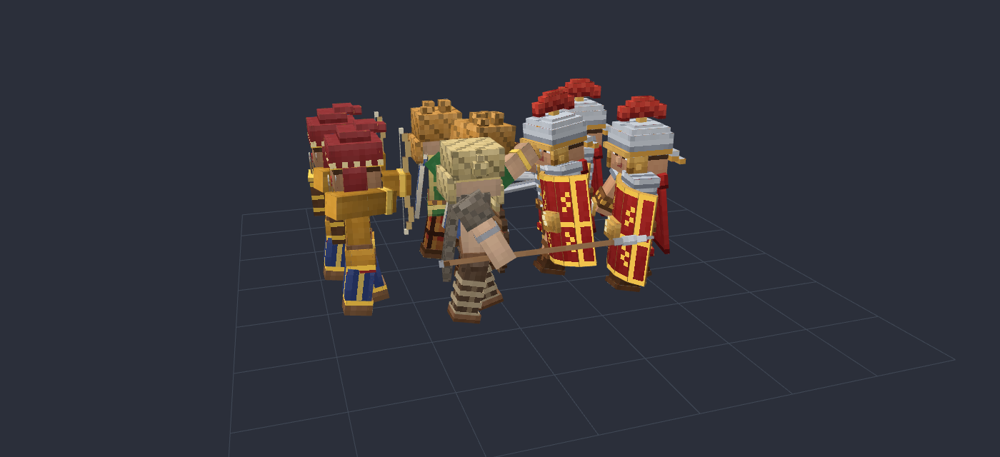
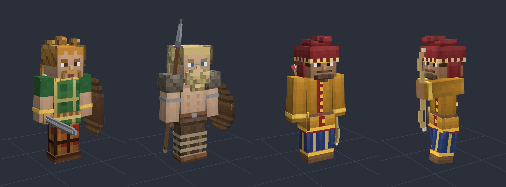
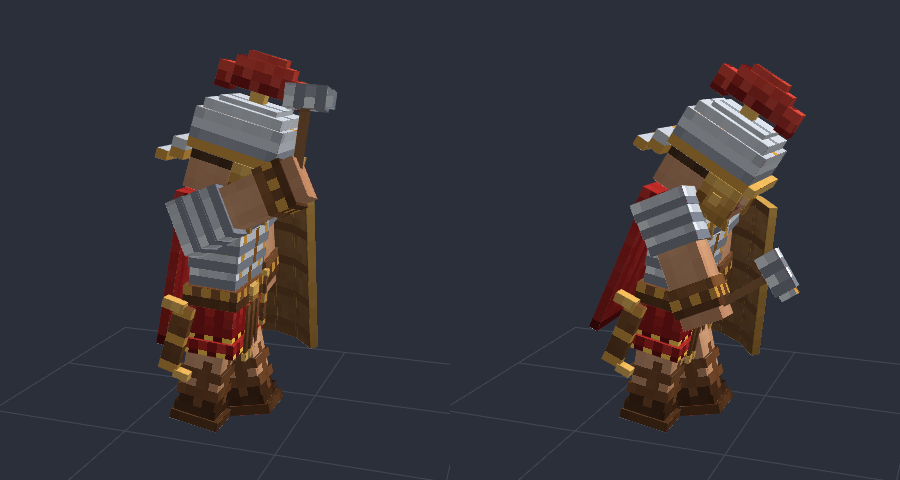
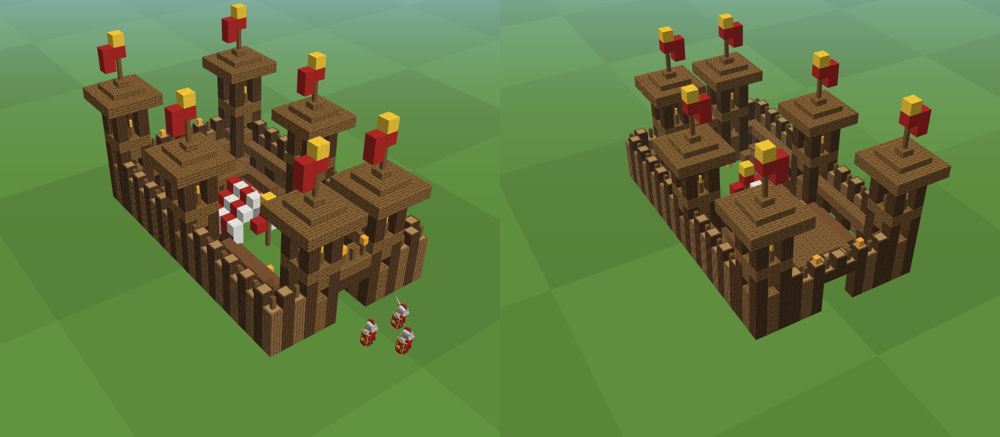

# Batalha Romana (add-on Minecraft Bedrock + modelos do Blockbench)

O legionário romano contra os inimigos de Roma na época do Império:

| Inimigo | Arma | Visual | Onde aparece |
|---|---|---|---|
| **Guerreiro Gaulês** | espada longa celta (dano 7) + escudo oval | cabelo espetado, bigodão, torque de ouro, túnica e calça xadrez, manto azul | planícies e florestas, grupos de 2–4 |
| **Guerreiro Germânico** | framea, a lança (dano 6) + escudo redondo | coque suevo, barba trançada, pele de lobo nos ombros, peito nu, faixas nas pernas | taigas e florestas, grupos de 2–4 |
| **Arqueiro Parto** | arco recurvo (flechas, de longe) | gorro curvado com abas, túnica açafrão, calça bufante, aljava com flechas, punhal | desertos, savanas e mesas, grupos de 1–3 |





## Arquivos

| Arquivo | Para que serve |
|---|---|
| `BatalhaRomana.mcaddon` | Add-on completo: **inclui o Soldado Romano** e os três inimigos |
| `guerreiro_gaules.bbmodel`, `guerreiro_germano.bbmodel`, `arqueiro_parto.bbmodel` | Projetos do Blockbench (modelo, textura e animações) |
| `pacote_recursos/`, `pacote_comportamento/` | O conteúdo do add-on, aberto |

O modelo do legionário está em `../soldado_romano/soldado_romano.bbmodel`.

> Use **só este add-on**: ele já traz o legionário. Se o `SoldadoRomano.mcaddon` também estiver
> ativo no mundo, os dois brigam pelo mesmo `romano:legionario`.

## Como jogar

1. Abra `BatalhaRomana.mcaddon` e ative os dois pacotes no mundo (com comandos/trapaças ligados para usar `/function`).
2. Vá para um lugar plano e digite:
   - `/function batalha`: 6 legionários contra 2 gauleses, 2 germânicos e 2 arqueiros partos.
   - `/function batalha_grande`: o dobro de gente.
3. Ou use os ovos: **Gerar Guerreiro Gaulês**, **Gerar Guerreiro Germânico**, **Gerar Arqueiro Parto** e **Gerar Soldado Romano**.

Comportamento:
- Os inimigos atacam legionários e jogadores. Os legionários atacam os inimigos (e monstros).
- Em combate, os guerreiros levantam o escudo e ficam em guarda; o arqueiro estica o arco e atira.
- Os inimigos deixam pepitas de ferro e de ouro quando morrem.

## Posto avançado: os legionários constroem




Os legionários erguem um **castellum de madeira** comprido, de 15 × 25 blocos, no formato de
"carta de baralho" dos acampamentos romanos:




- **Muralha de estacas pontudas** (troncos escuros alternando com troncos descascados).
- **Portão principal com guarita:** duas torres com seteiras, parapeito e telhado, ligadas por uma
  ponte por cima da passagem (3 × 3), com lanternas. **Portão dos fundos** (porta decumana) com verga.
- **Seis torres:** as duas do portão, duas no meio das muralhas compridas e duas nos cantos do fundo,
  todas com telhado com beiral e mastro com bandeira vermelha e ponta dourada.
- **Adarve:** passarela de tábuas por dentro de toda a muralha, apoiada em postes, com quatro escadas.
- **Rua central** do portão até a **principia**, a tenda listrada do comandante, com o **estandarte** da águia na frente.
- **Oito tendas dos soldados** em fileiras dos dois lados da rua, **celeiro (horreum)** de tábuas no
  fundo com feno e barril, duas fogueiras, lanternas na rua, barris, bancada e bigorna.

- **Sozinhos:** quando 3 ou mais legionários estão juntos, sem inimigos num raio de 24 blocos e sem
  outro posto num raio de 48, eles decidem construir (a cada 30 s há uma chance).
- **Sob ordem:** `/function posto_avancado` (ou `/scriptevent romano:construir`) manda os legionários
  livres até 32 blocos construírem para onde você está olhando, com o portão virado para você
  (o portão fica uns 4 blocos à sua frente e o forte se estende 25 blocos para trás).
- **Como aparece:** até 4 soldados trocam o gládio por um martelo, vão até a obra e martelam; os
  blocos surgem um por um (muralha de baixo para cima, depois torres, portão, adarve, telhados e acampamento),
  com som de madeira e partículas. O muro é feito pelo lado de fora, então ninguém fica preso.
  São 1186 blocos: cerca de 1 minuto e meio com 3 construtores, uns 75 segundos com 4.
- Se aparece um inimigo, quem está em combate larga o martelo e luta; depois outros são chamados de volta.
- O posto só ocupa espaço livre: grama e flores são trocadas, mas nada que você construiu é destruído.
  Terreno muito irregular (mais de 4 blocos de desnível) ou com água é recusado.
- `/function cancelar_obras` cancela as obras em andamento.

## IA mais esperta

- **Legionários:** chamam os companheiros quando um é atacado; o scutum segura metade do dano das
  flechas (parede de escudos); com pouca vida recuam por 6 s; feridos longe da luta se curam.
- **Bárbaros:** também chamam ajuda; com pouca vida perdem a coragem e fogem por 8 s.
- **Arqueiro parto:** mantém distância — se um romano chega a 6 blocos, ele recua e volta a atirar de longe.

O posto usa a API de scripts do Bedrock (`@minecraft/server` 1.11.0, já embutida no add-on). Precisa do
Minecraft Bedrock 1.21 ou mais novo.

## Animações (aba Animate do Blockbench)

- Legionário (`../soldado_romano/soldado_romano.bbmodel`): também `construir` (martelando)

- Gaulês e germânico: `parado`, `andar`, `combate`, `atacar`
- Arqueiro: `parado`, `andar`, `combate` (mira, puxa a corda e solta)

## Mudar os modelos

Gerados por `tools/gerar_batalha_romana.py` (usa `tools/mc_lib.py`, `tools/gerar_soldado_romano.py` e os scripts de `tools/scripts_batalha/`):

```bash
python3 tools/gerar_batalha_romana.py
```
