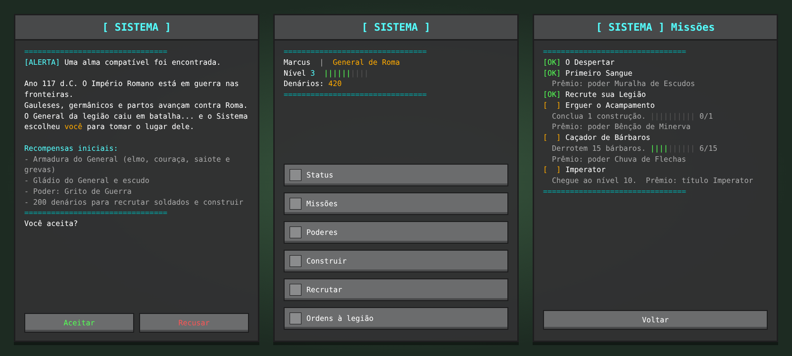
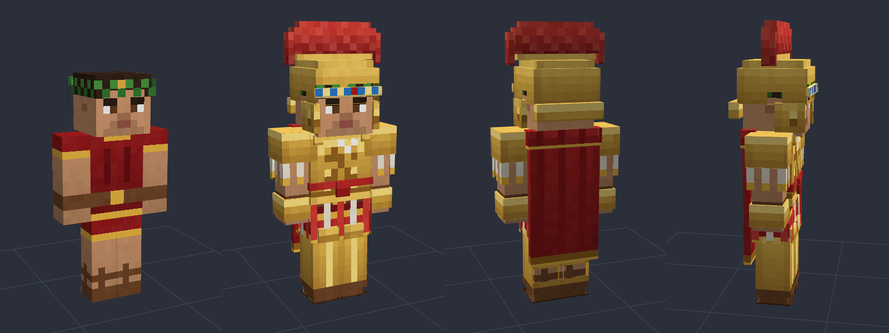
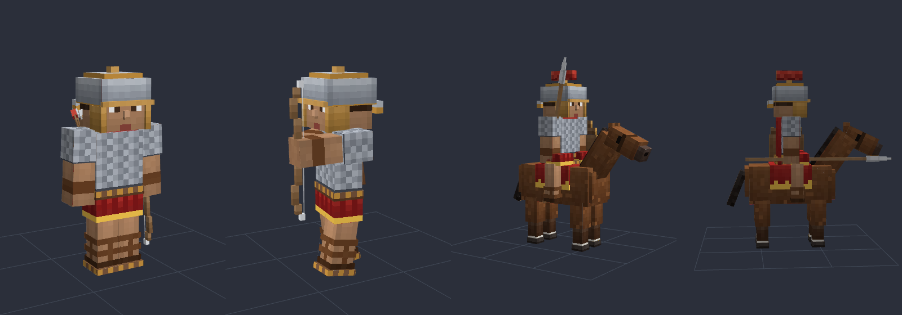
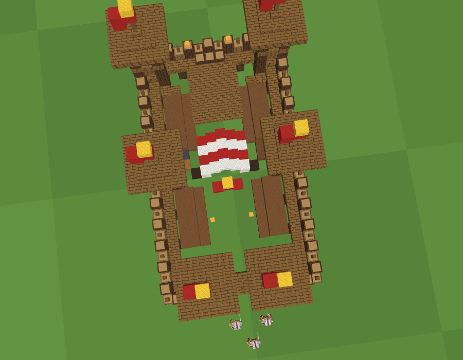
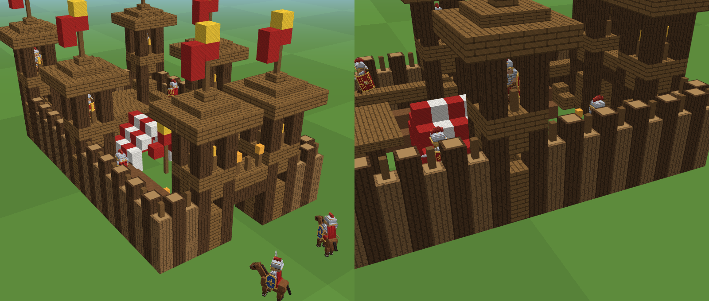
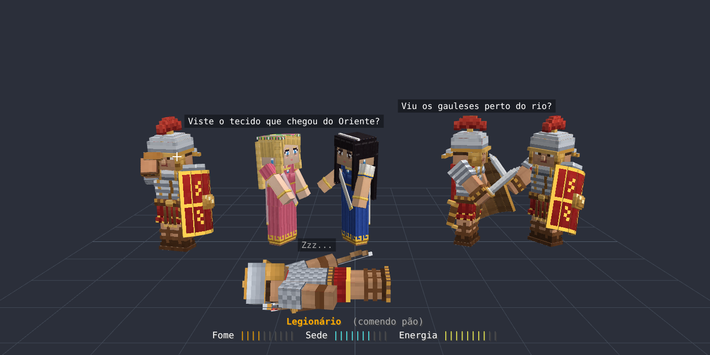
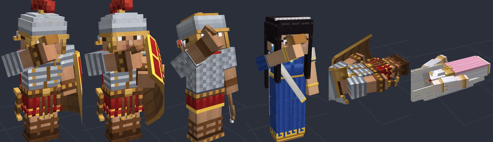

# Batalha Romana (add-on Minecraft Bedrock + modelos do Blockbench)

O legionário romano contra os inimigos de Roma na época do Império:

| Inimigo | Arma | Visual | Onde aparece |
|---|---|---|---|
| **Guerreiro Gaulês** | espada longa celta (dano 7) + escudo oval | cabelo espetado, bigodão, torque de ouro, túnica e calça xadrez, manto azul | planícies e florestas, grupos de 2–4 |
| **Guerreiro Germânico** | framea, a lança (dano 6) + escudo redondo | coque suevo, barba trançada, pele de lobo nos ombros, peito nu, faixas nas pernas | taigas e florestas, grupos de 2–4 |
| **Arqueiro Parto** | arco recurvo (flechas, de longe) | gorro curvado com abas, túnica açafrão, calça bufante, aljava com flechas, punhal | desertos, savanas e mesas, grupos de 1–3 |


## O Sistema: você é o General de Roma



Na **primeira vez que você entra no mundo**, aparece uma janela no estilo dos animes de "outro mundo":
o **[ SISTEMA ]** encontrou uma alma compatível e escolheu você para substituir o General que caiu em
batalha. (Se clicar em Recusar... "Recusar não é uma opção".) Ao aceitar, você é vestido com a
**armadura do General** e recebe o item **Sistema**, o **Gládio do General**, um escudo, o poder
**Grito de Guerra** e 200 denários.



- **Armadura do General** (4 peças em 3D que acompanham seus movimentos): elmo dourado com diadema e
  **crista vermelha atravessada** de comandante, couraça anatômica dourada com águia, faixa vermelha e
  **capa longa**, ombreiras com tiras de couro, braceletes, saiote de tiras (pteruges) e grevas douradas
  com sandálias.
- **Seu corpo novo**: a skin **General Romano** (`SkinGeneralRomano.mcpack`, também dentro do
  `.mcaddon`): pele morena, cabelo curto escuro no estilo romano, coroa de louros, túnica vermelha com
  barra dourada e sandálias. ⚠️ O Minecraft não deixa um add-on trocar sua skin sozinho: depois de
  importar, escolha **General Romano** no Vestiário (Dressing Room → Skins clássicas). Com a armadura
  vestida você já fica com cara de general de qualquer jeito.

Abra o Sistema **usando o item Sistema** (ou `/function sistema`). O menu tem:

| Botão | O que faz |
|---|---|
| **Status** | nível, XP, denários, título, sua legião e bárbaros derrotados |
| **Missões** | 9 missões com barra de progresso; cada uma dá XP, denários, **poderes novos** ou o título *Imperator* |
| **Poderes** | 7 poderes com recarga (veja abaixo) |
| **Construir** | ergue um **forte** (300 den.), uma **torre de vigia** (80) ou uma **muralha com portão** (150) na direção para onde você olha. Os legionários livres por perto constroem; sem soldados, **o próprio Sistema ergue a obra** com brilho azul |
| **Recrutar** | **legionário** (50 den.), **arqueiro romano** (60) ou **cavaleiro** (120); eles seguem você |
| **Ordens à legião** | *Sigam-me*, *Aguardem aqui*, *Montem guarda* (vão patrulhar o forte mais perto) e *Reunir!* |

**Poderes** (o primeiro vem de início, os outros pelas missões):

| Poder | Efeito | Recarga |
|---|---|---|
| Grito de Guerra | legião ganha força e velocidade; bárbaros perto ficam fracos e lentos | 45 s |
| Muralha de Escudos | você e a legião ganham resistência por 15 s | 60 s |
| Bênção de Minerva | cura você e os soldados romanos perto | 75 s |
| Chamar a Cavalaria | três cavaleiros romanos chegam e seguem você | 150 s |
| Chuva de Flechas | flechas caem do céu sobre os inimigos à sua frente | 50 s |
| Fúria de Marte | força II, velocidade e regeneração por 20 s | 90 s |
| Raio de Júpiter | raios atingem até 6 inimigos perto | 120 s |

Você ganha XP e denários derrotando bárbaros (a sua legião também conta), concluindo construções e
missões; a cada nível o Sistema avisa **LEVEL UP!** e dá mais denários. `/function reiniciar_sistema`
apaga seu progresso e mostra a chegada do General de novo.

## Tropas romanas: legionários, arqueiros e cavalaria



- **Arqueiro romano (sagittarius)**: galea de ferro, cota de malha, túnica vermelha, arco recurvo e
  aljava; atira de longe, recua se um bárbaro chega perto e prefere vigiar as torres.
- **Cavaleiro romano (eques)**: cavalo baio de crina preta com manta vermelha e sela romana de quatro
  pontas; o cavaleiro tem cota de malha, capa, galea com penacho, **lança comprida** e escudo oval azul
  (parma). Galopa, empina no ataque e dá 8 de dano.
- `/function batalha` agora também traz 2 arqueiros e 2 cavaleiros do lado romano.

## Arquivos

| Arquivo | Para que serve |
|---|---|
| `BatalhaRomana.mcaddon` | Add-on completo: **inclui o Soldado Romano** e os três inimigos |
| `guerreiro_gaules.bbmodel`, `guerreiro_germano.bbmodel`, `arqueiro_parto.bbmodel` | Projetos do Blockbench dos inimigos |
| `sagitario_romano.bbmodel`, `cavaleiro_romano.bbmodel` | Arqueiro e cavaleiro romanos |
| `elmo_general.bbmodel`, `couraca_general.bbmodel`, `saiote_general.bbmodel`, `grevas_general.bbmodel` | As 4 peças da armadura do General |
| `SkinGeneralRomano.mcpack` | A skin do General (também vai dentro do `.mcaddon`) |
| `pacote_recursos/`, `pacote_comportamento/` | O conteúdo do add-on, aberto |

O modelo do legionário está em `../soldado_romano/soldado_romano.bbmodel`.

> Use **só este add-on**: ele já traz o legionário. Se o `SoldadoRomano.mcaddon` também estiver
> ativo no mundo, os dois brigam pelo mesmo `romano:legionario`.

## Como jogar

1. Abra `BatalhaRomana.mcaddon` e ative os dois pacotes no mundo (com comandos/trapaças ligados para usar `/function`).
2. Vá para um lugar plano e digite:
   - `/function batalha`: 6 legionários contra 2 gauleses, 2 germânicos e 2 arqueiros partos.
   - `/function batalha_grande`: o dobro de gente.
3. Ou use os ovos: **Gerar Guerreiro Gaulês**, **Gerar Guerreiro Germânico**, **Gerar Arqueiro Parto** e **Gerar Soldado Romano**.

Comportamento:
- Os inimigos atacam legionários e jogadores. Os legionários atacam os inimigos (e monstros).
- Em combate, os guerreiros levantam o escudo e ficam em guarda; o arqueiro estica o arco e atira.
- Os inimigos deixam pepitas de ferro e de ouro quando morrem.

## Posto avançado: os legionários constroem


Os legionários erguem um **castellum de madeira** comprido, de 15 × 25 blocos, no formato de
"carta de baralho" dos acampamentos romanos:




- **Muralha de estacas pontudas** (troncos escuros alternando com troncos descascados).
- **Portão principal com guarita:** duas torres com seteiras, parapeito e telhado, ligadas por uma
  ponte por cima da passagem (3 × 3), com lanternas. **Portão dos fundos** (porta decumana) com verga.
- **Seis torres:** as duas do portão, duas no meio das muralhas compridas e duas nos cantos do fundo,
  todas com telhado com beiral e mastro com bandeira vermelha e ponta dourada.
- **Adarve:** passarela de tábuas por dentro de toda a muralha, apoiada em postes, com quatro escadas.
- **Rua central** do portão até a **principia**, a tenda listrada do comandante, com o **estandarte** da águia na frente.
- **Oito tendas dos soldados** em fileiras dos dois lados da rua, **celeiro (horreum)** de tábuas no
  fundo com feno e barril, duas fogueiras, lanternas na rua, barris, bancada e bigorna.

- **Sozinhos:** quando 3 ou mais legionários estão juntos, sem inimigos num raio de 24 blocos e sem
  outro posto num raio de 48, eles decidem construir (a cada 30 s há uma chance).
- **Sob ordem:** `/function posto_avancado` (ou `/scriptevent romano:construir`) manda os legionários
  livres até 32 blocos construírem para onde você está olhando, com o portão virado para você
  (o portão fica uns 4 blocos à sua frente e o forte se estende 25 blocos para trás).
- **Como aparece:** até 4 soldados trocam o gládio por um martelo, vão até a obra e martelam; os
  blocos surgem um por um (muralha de baixo para cima, depois torres, portão, adarve, telhados e acampamento),
  com som de madeira e partículas. O muro é feito pelo lado de fora, então ninguém fica preso.
  São 1186 blocos: cerca de 1 minuto e meio com 3 construtores, uns 75 segundos com 4.
- Se aparece um inimigo, quem está em combate larga o martelo e luta; depois outros são chamados de volta.
- O posto só ocupa espaço livre: grama e flores são trocadas, mas nada que você construiu é destruído.
  Terreno muito irregular (mais de 4 blocos de desnível) ou com água é recusado.
- `/function cancelar_obras` cancela as obras em andamento.

## Patrulha: os soldados vigiam o forte



Quando uma construção fica pronta (forte, torre ou muralha), soldados livres num raio de 40 blocos
**sobem nela**:

- **Vigias nas torres**: um por torre (arqueiros têm preferência), parados no alto olhando em volta.
- **Rondas na passarela**: legionários andam de um lado para o outro nos trechos do adarve, com a
  animação de marcha, e dão meia-volta nas pontas.
- Se aparece um inimigo, a sentinela larga o posto e desce para lutar; depois outro soldado assume.
- Soldados que estão seguindo você não são chamados; use **Ordens → Montem guarda** para mandá-los.

## Vida dos NPCs: fome, sede, sono, comida e conversas com voz





Legionários, arqueiros romanos e a **família nobre** (Aurélia, Lívia, Cornélia, Júlia e Aélia, que
agora existem no jogo: `/function familia_nobre`) têm **fome**, **sede** e **energia** de 0 a 100. Elas
caem com o tempo, mais rápido em combate, e cada NPC decide sozinho o que fazer quando está livre:

| Necessidade | O que o NPC faz |
|---|---|
| Fome | pega um **pão** ou uma **tigela de sopa** na mão e come, com som de mastigar |
| Sede | pega uma **caneca** e bebe, inclinando a cabeça para trás |
| Cansaço / noite | **deita para dormir**, fecha os olhos e aparece **"Zzz..."** em cima da cabeça; acorda de manhã |
| Tudo em ordem | procura outro NPC livre perto e **conversa** |

- **Conversas**: os dois se viram um para o outro, gesticulam e trocam falas em português que aparecem
  **em cima da cabeça**, cada fala com **voz de personagem**. São 22 conversas: soldados falam de
  gauleses, do pagamento, do forte e do General; as nobres falam de seda, banquetes, poesia e do General;
  e há conversas entre soldados e nobres. Quem está com fome ou sono comenta isso na conversa.
- **Vozes**: falas sintetizadas numa "língua de personagem", como em jogos de RPG, em 4 timbres:
  soldado, general, nobre e matrona. Cada NPC tem um tom de voz só dele. Ouça as amostras em `amostras_voz/`.
- **Olhe para um NPC** e aparece na tela o nome, o que ele está fazendo e as barras de **Fome**,
  **Sede** e **Energia**.
- Quando você chega perto, eles cumprimentam: *"Ave, General!"*, *"Que os deuses o protejam."*
- Em combate, largam o pão, acordam ou param de conversar e vão lutar. Sentinelas e construtores só
  param o serviço se a necessidade estiver crítica.
- As necessidades ficam salvas em cada NPC: valem depois de sair e voltar ao mundo.

## IA mais esperta

- **Legionários:** chamam os companheiros quando um é atacado; o scutum segura metade do dano das
  flechas (parede de escudos); com pouca vida recuam por 6 s; feridos longe da luta se curam.
- **Bárbaros:** também chamam ajuda; com pouca vida perdem a coragem e fogem por 8 s.
- **Arqueiro parto:** mantém distância — se um romano chega a 6 blocos, ele recua e volta a atirar de longe.

Os scripts usam a API do Bedrock (`@minecraft/server` 1.11.0 e `@minecraft/server-ui` 1.2.0, já
declaradas no add-on). Precisa do Minecraft Bedrock 1.21 ou mais novo.

## Animações (aba Animate do Blockbench)

- Legionário (`../soldado_romano/soldado_romano.bbmodel`): também `construir` (martelando)
- Legionário, arqueiro romano e nobres: `comer` (pão), `tomar_sopa`, `beber` (caneca), `dormir` e `conversar`
- Arqueiro romano: `parado`, `andar`, `combate`; cavaleiro: `parado`, `andar` (galope), `combate`, `atacar` (empina e estoca)

- Gaulês e germânico: `parado`, `andar`, `combate`, `atacar`
- Arqueiro: `parado`, `andar`, `combate` (mira, puxa a corda e solta)

## Mudar os modelos

Gerados por `tools/gerar_batalha_romana.py` (usa `tools/mc_lib.py`, `tools/gerar_soldado_romano.py` e os scripts de `tools/scripts_batalha/`):

```bash
python3 tools/gerar_batalha_romana.py
```
