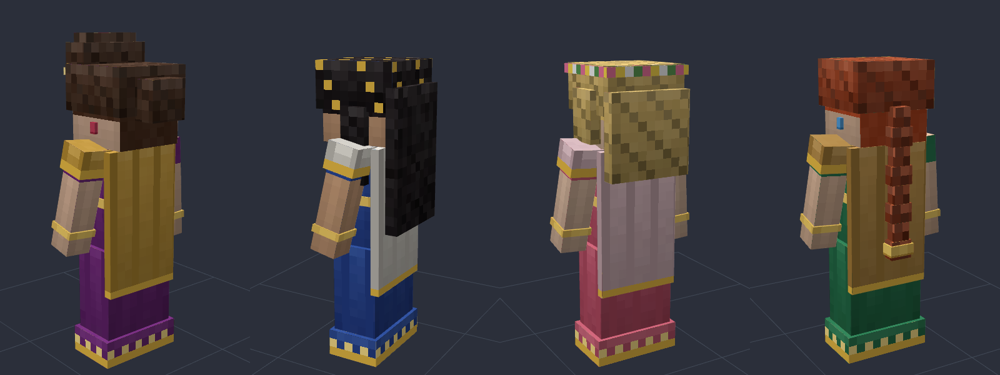
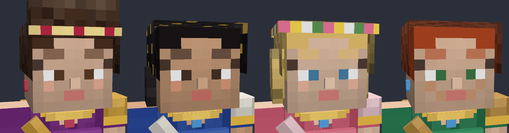

# Família nobre romana: 4 NPCs (modelos para o Blockbench)

Só os modelos, ainda sem comportamento no jogo. Todas são mulheres adultas de uma família patrícia,
vestidas como as nobres de Roma: **stola** (vestido longo) com barra dourada bordada, cinto sob o busto,
**palla** (manto) cruzando o peito e caindo nas costas, colar com pingente, brincos, pulseiras e sandálias.

| Arquivo | Quem é | Visual |
|---|---|---|
| `aurelia.bbmodel` | **Aurélia**, a matrona (mãe) | stola roxa e palla dourada; cachos altos no estilo das damas do Império, diadema com rubis e coque |
| `livia.bbmodel` | **Lívia**, a filha mais velha | stola azul e palla branca; cabelo preto longo até a cintura, com rede de ouro |
| `cornelia.bbmodel` | **Cornélia**, a irmã | stola rosa e palla rosa-clara; cachos loiros, olhos azuis e coroa de flores |
| `julia.bbmodel` | **Júlia**, a prima | stola verde e palla dourada; trança ruiva comprida com laço de ouro, olhos verdes e sardas |

Animações (aba **Animate**): `parado`, `andar`, `acenar` e `conversar`.

Os modelos são gerados por `tools/gerar_nobres_romanas.py` (`python3 tools/gerar_nobres_romanas.py`).
