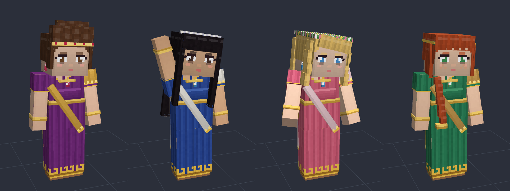

# Família nobre romana: 4 NPCs (modelos para o Blockbench)

Só os modelos, ainda sem comportamento no jogo. Todas são mulheres adultas de uma família patrícia,
vestidas como as nobres de Roma: **stola** (vestido longo) com barra dourada bordada, cinto sob o busto,
**palla** (manto) cruzando o peito e caindo nas costas, colar com pingente, brincos, pulseiras e sandálias.

Estilo: o mesmo corpo do jogador e do soldado (tronco 8×12×4, braços de 3 como a skin "Alex", pernas
4×12×4, com o vestido nas pernas como numa skin), rosto em
resolução dobrada (16 × 16) com olhos grandes, cílios e brilho, bochechas rosadas e boca delicada, e
cabelo em camadas 3D: franja, mechas que emolduram o rosto e volume atrás.

| Arquivo | Quem é | Visual |
|---|---|---|
| `aurelia.bbmodel` | **Aurélia**, a matrona (mãe) | stola roxa e palla dourada; coroa de cachos altos no estilo das damas do Império, diadema com rubis e coque |
| `livia.bbmodel` | **Lívia**, a filha mais velha | stola azul e palla branca; cabelo preto liso até a cintura, franja reta e tiara de pérolas |
| `cornelia.bbmodel` | **Cornélia**, a irmã | stola rosa e palla rosa-clara; franja de lado, cachos loiros caindo nos ombros, olhos azuis e coroa de flores |
| `julia.bbmodel` | **Júlia**, a prima | stola verde e palla dourada; trança ruiva grossa caindo pela frente do ombro, com laço de ouro, olhos verdes e sardas |

Animações (aba **Animate**): `parado`, `andar`, `acenar` e `conversar`.

Os modelos são gerados por `tools/gerar_nobres_romanas.py` (`python3 tools/gerar_nobres_romanas.py`).
