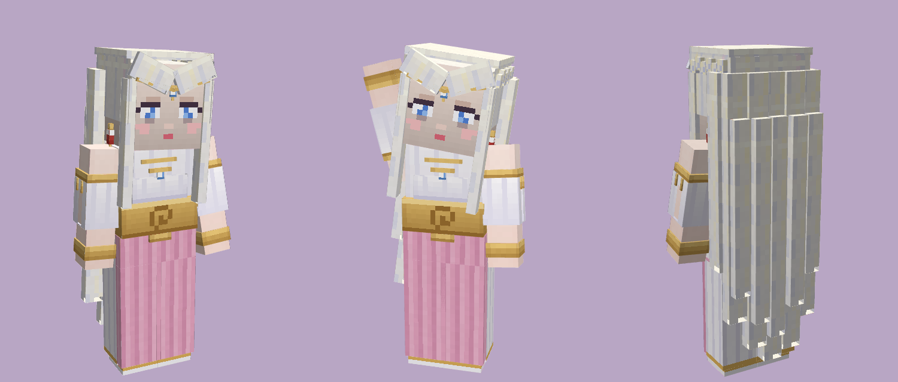
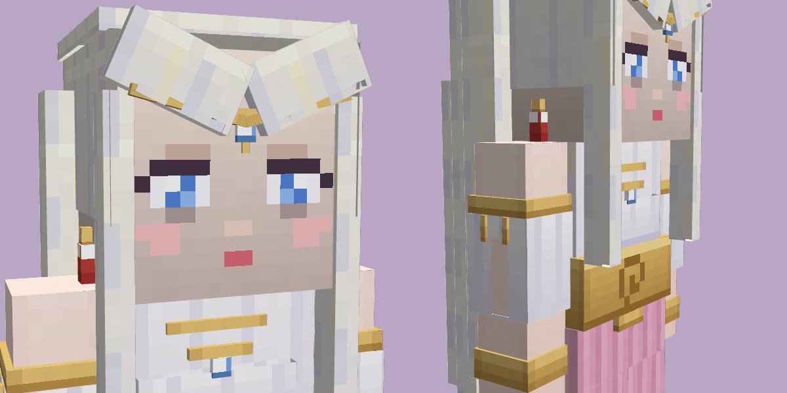

# Aélia (modelo para o Blockbench)

Personagem feita a partir de uma ilustração de referência, com o mesmo corpo do jogador e do soldado
(tronco 8×12×4, braços de 3 como a skin "Alex", pernas 4×12×4, com a saia nas pernas como numa skin).

- **Cabelo** platinado muito longo e ondulado, com reflexos lilás, dourados e rosados; risca no meio
  com franja abrindo para as têmporas, mechas finas emoldurando o rosto, volume dos lados e as costas
  em mechas de comprimentos diferentes; **trança** fazendo uma coroa do lado esquerdo.
- **Tiara** de correntinha dourada com uma **joia azul** pendurada no meio da testa.
- **Rosto** em resolução dobrada: olhos azuis grandes com brilho, cílios, bochechas bem rosadas e boca pequena.
- **Brincos** de ouro com gota vermelha e franjinha dourada.
- **Blusa branca** de gola alta de renda com os **ombros de fora**, mangas brancas soltas com fenda,
  **braçadeira dourada** com pingentes, colar duplo com safira.
- **Corpete dourado** em ponta com arabescos, **saia rosa** com sobressaia branca aberta na frente,
  pulseiras de ouro e sapatilhas.

Animações (aba **Animate**): `parado`, `andar`, `acenar` e `conversar`.

Gerado por `tools/gerar_personagem_aelia.py` (`python3 tools/gerar_personagem_aelia.py`).
