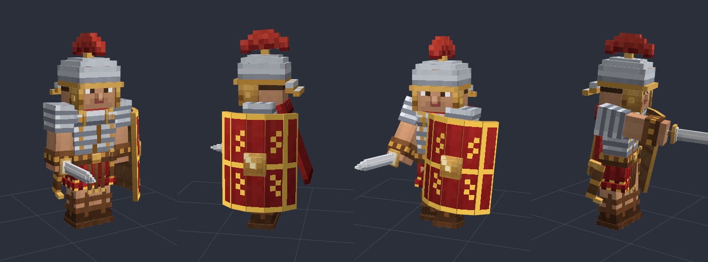
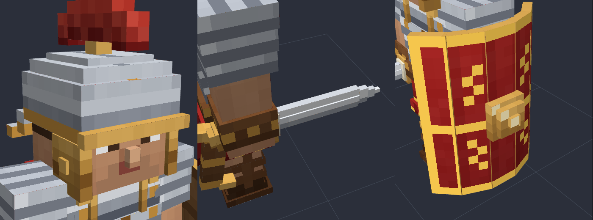

# Soldado Romano (Minecraft Bedrock + Blockbench)

Um legionário romano com galea (capacete de aço com bochecheiras de bronze e penacho vermelho),
lorica segmentata (armadura de placas), túnica e capa vermelhas, cinto com avental de tiras,
sandálias (caligae), gládio na mão direita e scutum (escudo curvo vermelho e dourado) na esquerda.

Tudo modelado em volume: a armadura tem placas sobrepostas e ombreiras em três camadas, o capacete
tem cúpula, viseira, nuca larga e penacho em degraus, as sandálias têm tiras vazadas, o escudo é
curvo de verdade (cinco painéis em arco com umbo em domo) e o gládio tem lâmina com nervura,
ponta afunilada, guarda, cabo com anéis de marfim e pomo. No cinto ficam a bainha e um punhal.

## Arquivos

| Arquivo | Para que serve |
|---|---|
| `soldado_romano.bbmodel` | Projeto do **Blockbench** (modelo, textura e 5 animações) |
| `soldado_romano.png` | Textura 256×256 |
| `SoldadoRomano.mcaddon` | Add-on pronto para o Minecraft Bedrock |
| `pacote_recursos/`, `pacote_comportamento/` | O conteúdo do add-on, aberto, para editar |

## Abrir no Blockbench

**File → Open Model** → `soldado_romano.bbmodel`. Na aba **Animate**:
- `parado`: respira, olha em volta, a capa balança
- `andar`: marcha com a capa esvoaçando
- `combate`: postura de batalha, escudo na frente e gládio em guarda
- `atacar`: estocada com o gládio
- `saudar`: braço erguido ("Ave!")

## Usar no Minecraft (Bedrock)

Abra `SoldadoRomano.mcaddon`, ative os dois pacotes no mundo e use o ovo **Gerar Soldado Romano**
(ou `/summon romano:legionario`).

- Ele patrulha (e procura vilas), luta contra monstros (menos creepers) e revida se for atacado.
- Quando tem um alvo, entra em postura de combate e ataca com estocadas (dano 6, 30 de vida).
- Não aparece sozinho no mundo: só pelo ovo ou pelo comando.

## Mudar o modelo

Gerado por `tools/gerar_soldado_romano.py`: edite e rode `python3 tools/gerar_soldado_romano.py`.
