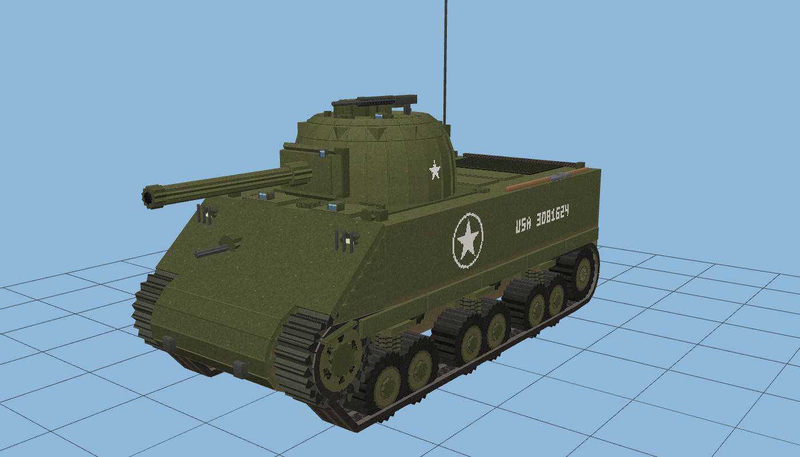
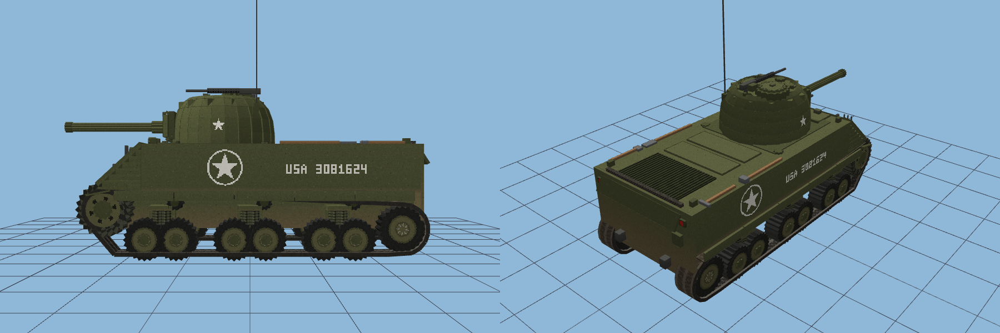

# Tanque M4A3(75)W Sherman — modelo + add-on

Refeito com as medidas reais do M4A3(75)W: 2,94 m de altura até a cúpula, ~2,6 m de largura,
~5,9 m de comprimento, 2,11 m entre o centro das esteiras, 43 cm de vão livre e o canhão a 2,24 m do chão.
Escala de verdade no Minecraft: 1 bloco = 1 metro (o tanque ocupa uns 6 × 3 × 3 blocos).

**O que mudou para parecer um Sherman de verdade**: torre fundida arredondada (feita de 120 placas
inclinadas, mais estreita na frente e com a "bunda" atrás), mantlet M34A1 de face inteira com o escudo
do rotor, canhão de 75 mm com o comprimento certo, placa frontal a 47° que vai até o teto,
nariz da transmissão arredondado, sponsons sobre as esteiras, escotilhas grandes do motorista,
cúpula de visão do comandante com blocos de vidro, escotilha oval do carregador, .50 no teto,
suspensão VVSS (3 truques por lado, molas volutas, roletes de retorno em cima), roda dentada
na frente e esteira de borracha T48.

## Add-on (TanqueSherman.mcaddon)

Abra o `TanqueSherman.mcaddon` (instala os dois pacotes), ative no mundo com **Beta APIs** ligado
(precisa por causa do script). Depois, no chat: `/function sherman` — aparece um Sherman na sua
frente e você ganha 32 granadas de 75 mm e a metralhadora .50.

| Ação | Como |
| --- | --- |
| Entrar | clique direito no tanque (2 lugares: comandante e um na traseira) |
| Dirigir | WASD — a frente segue para onde você olha |
| Sair | agachar |
| Canhão de 75 mm | segure a **Granada de 75 mm** e clique direito: explosão onde mirar (recarga de 3 s) |
| Metralhadora .50 | segure a **Metralhadora .50** e clique direito (rajada) |

A torre e o canhão giram e sobem/descem seguindo a sua mira, o canhão recua no tiro, as rodas giram
quando anda, sai fumaça do escapamento e tem som de motor, tiro e impacto. Na tela aparece a
blindagem (400) e se o canhão está pronto. O tanque não toma dano de queda, fogo nem afogamento e
aguenta flechas; quando é destruído, explode e deixa ferro.

- `/function sherman_sem_destruicao` — o canhão para de quebrar blocos (`sherman_com_destruicao` volta).
- Receitas: granadas (ferro + pólvora + pepita de ouro), metralhadora e o próprio tanque
  (blocos de ferro, carrinhos e bloco de redstone).
- Também aparece o ovo **Tanque Sherman** no inventário criativo.

Gerado por `tools/gerar_sherman.py` (modelo) e `tools/gerar_addon_sherman.py` (add-on);
o script do jogo fica em `tools/scripts_sherman/main.js`.
