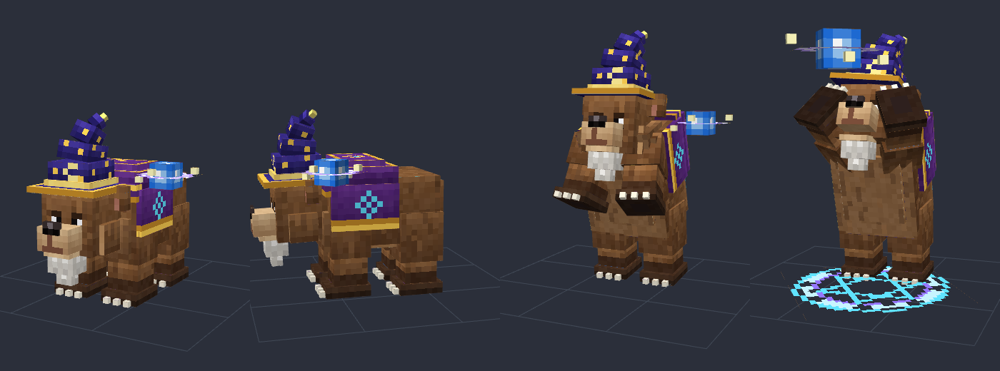

# Urso Mago (Minecraft Bedrock + Blockbench)

Um urso marrom com chapéu de mago curvado (faixa dourada, lua e estrela na ponta), manto roxo
com gola dourada e runas, barbinha de mago, garras e um orbe mágico com anel flutuando ao lado.
Ele anda de quatro patas, **fica em pé quando quer** e **usa magia** quando é atacado.



## Arquivos

| Arquivo | Para que serve |
|---|---|
| `urso_mago.bbmodel` | Projeto do **Blockbench** (modelo, textura e 6 animações, tudo num arquivo só) |
| `urso_mago.png` | Textura 256×256 |
| `UrsoMago.mcaddon` | Add-on pronto: dois cliques e ele abre no Minecraft Bedrock |
| `pacote_recursos/`, `pacote_comportamento/` | O conteúdo do add-on, aberto, para editar |

## Abrir no Blockbench

1. Blockbench → **File → Open Model** → escolha `urso_mago.bbmodel`.
2. Aba **Animate** (canto superior direito) para ver as animações:
   - `parado`, `andar` (de quatro patas)
   - `levantar` (com rugido) → `em_pe` → `abaixar` (ficar em pé e voltar)
   - `magia` (em pé, braços para frente, orbe girando e círculo de runas no chão)
3. O círculo de runas fica escondido (escala 0) em todas as animações menos `magia`.

Ossos principais: `quadril` (gira o corpo para ficar em pé), `cabeca`, `mandibula` (abre no rugido), `orelha_*`, `chapeu`,
`perna_dianteira_*`, `perna_traseira_*`, `orbe` e `circulo_magico`.

## Usar no Minecraft (Bedrock)

Abra `UrsoMago.mcaddon` (ou copie as pastas para `resource_packs` e `behavior_packs`),
ative os dois pacotes no mundo e use o ovo **Gerar Urso Mago** (ou `/summon mago:urso_mago`).

Comportamento:
- De vez em quando (a cada 15 a 40 s) ele **levanta sozinho**, fica em pé de 6 a 14 s e volta para quatro patas.
- Se alguém bater nele, ele levanta e **lança magia**: presas mágicas (iguais às do Evocador) em círculo quando você está perto, ou em linha até 16 blocos.
- Aparece naturalmente em florestas e taigas.

## Mudar o modelo

O modelo é gerado por `tools/gerar_urso_mago.py`. Edite e rode:

```bash
python3 tools/gerar_urso_mago.py
```

Também dá para editar direto no Blockbench e exportar com
**File → Export → Export Bedrock Geometry** / **Export Animations**.
